# Exercise 1 - ReadQC
- Author: FGCZ
- Date: 26/04/2024, steps rewritten for Omics-Studio 25/10/2026

Steps
1. [Open the course Omics-Studio](#1-open-the-course-omics-studio)
2. [Select your project](#2-select-your-project)
3. [Select DataSets](#3-select-datasets)
4. [Check the dataset](#4-check-the-dataset)
5. [Select FastqcApp](#5-select-fastqcapp)
6. [Keep the default parameters](#6-keep-the-default-parameters)
7. [Submit the job](#7-submit-the-job)
8. [Check the job status](#8-check-the-job-status)
9. [Open the FastQC dataset](#9-open-the-fastqc-dataset)
10. [Questions](#10-questions)

----

### 1. Open the course Omics-Studio

https://fgcz-course2.bfabric.org

No sign-in: the course copy is open to everybody in the course. The header says **Course**.

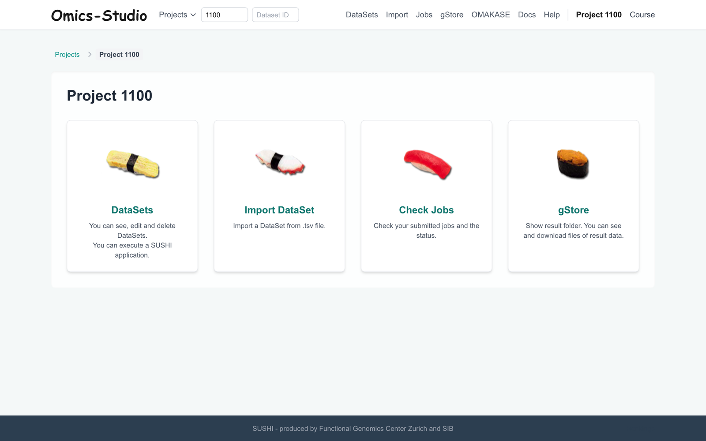

### 2. Select your project

Open **Projects** in the header and pick your project, or type its number into the **Project #...** box.
Your project number is in the table on the [course page](../README.md#hands-on-projects) (p1101, p1102, ...).
Each participant has a project of their own: work only in yours.

### 3. Select DataSets

Click **DataSets** in the header. Your project holds one dataset, `NextSeq500_20190507_NS278_o5638_subSampled`:
RNA-seq of human cells, 6 samples, cut down to 100 000 reads a sample so that the jobs finish during the course.

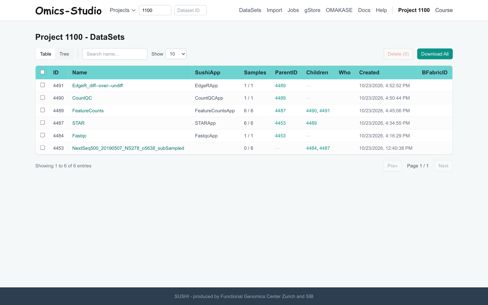

### 4. Check the dataset

Click the name of the dataset. **Dataset Information** describes it; the sample table lists the 6 samples.
The column `Condition [Factor]` gives the groups: 3 `undiff` and 3 `diff`.

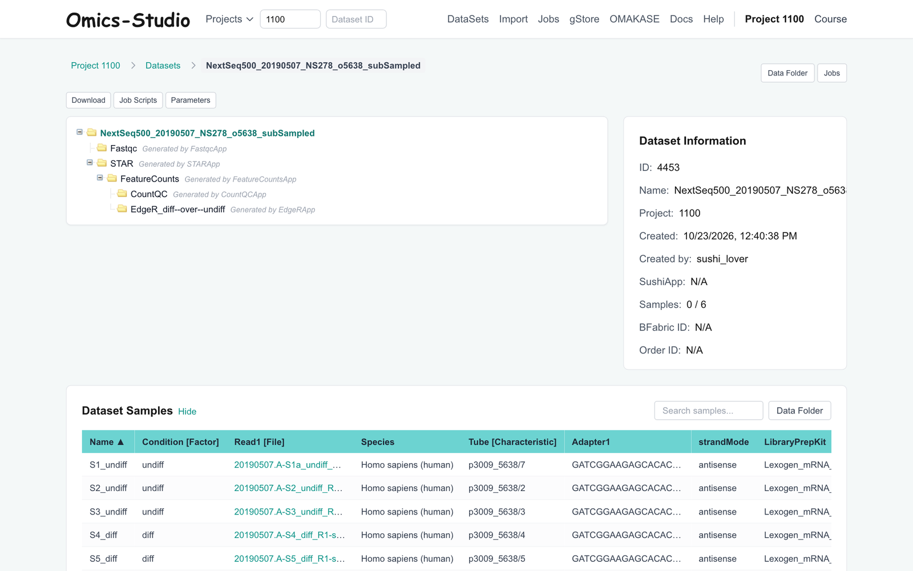

### 5. Select FastqcApp

**Runnable Applications** lists the apps that can read this dataset, grouped by category.
Select `FastqcApp` in the **QC** row.

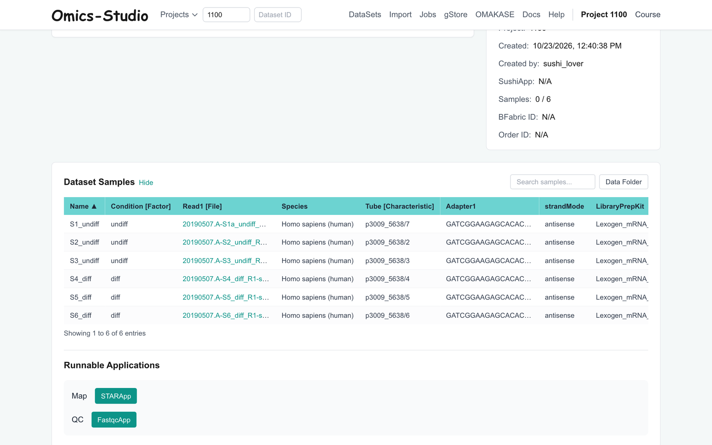

### 6. Keep the default parameters

The parameters come in a few pages. Keep the defaults, click **Next →** to the last page, then
**Continue to Review →**.

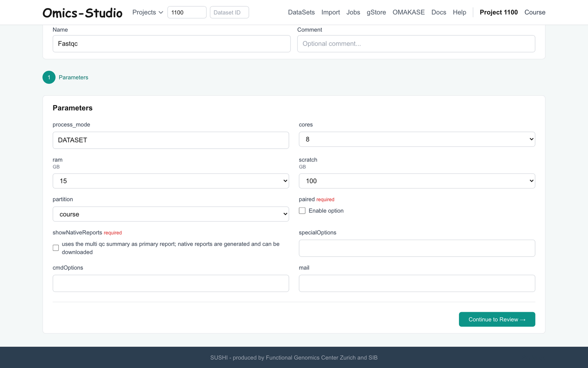

### 7. Submit the job

**Confirm Job Submission** shows the name of the result dataset and the parameters. Click **Confirm & Submit Job**.

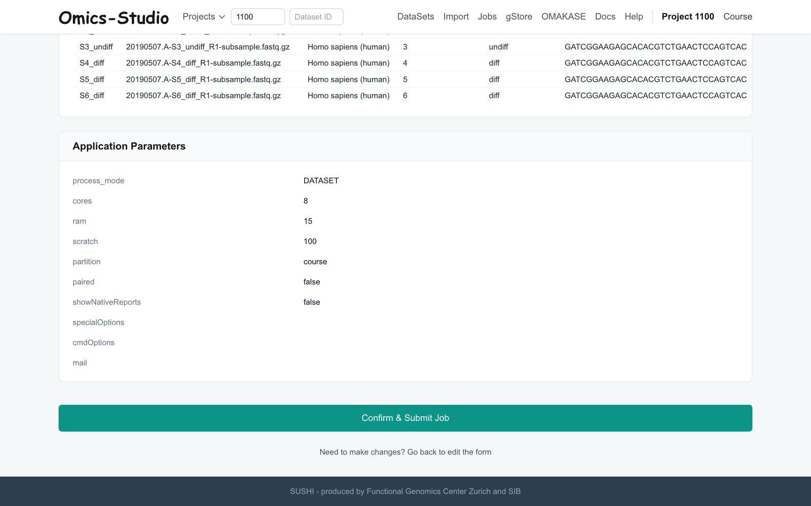

### 8. Check the job status

Click **Jobs** in the header. The status moves from `SUBMITTED` / `PENDING` (waiting for a free node) to
`RUNNING` and `COMPLETED`. The page asks again every 15 seconds by itself; please do not submit the same job twice.
If it says `FAILED`, open the job and read its log.

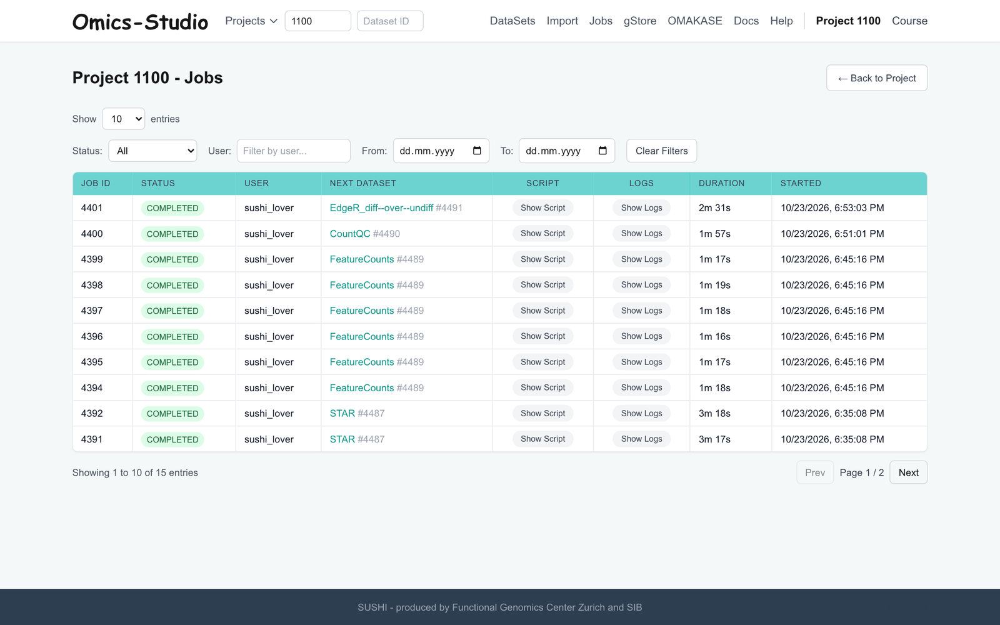

Open a job to see the script that ran (**Script Content**) and what it printed (**Execution Log**).
Both are kept after the job has finished.

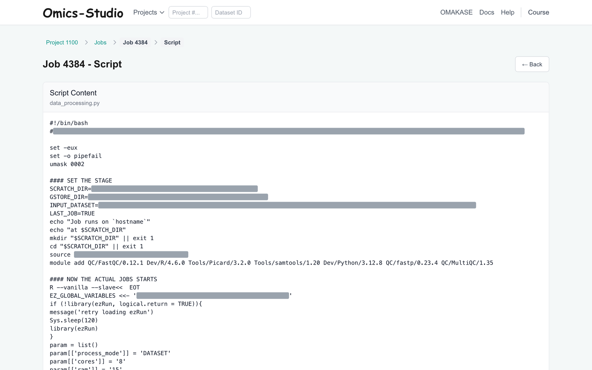 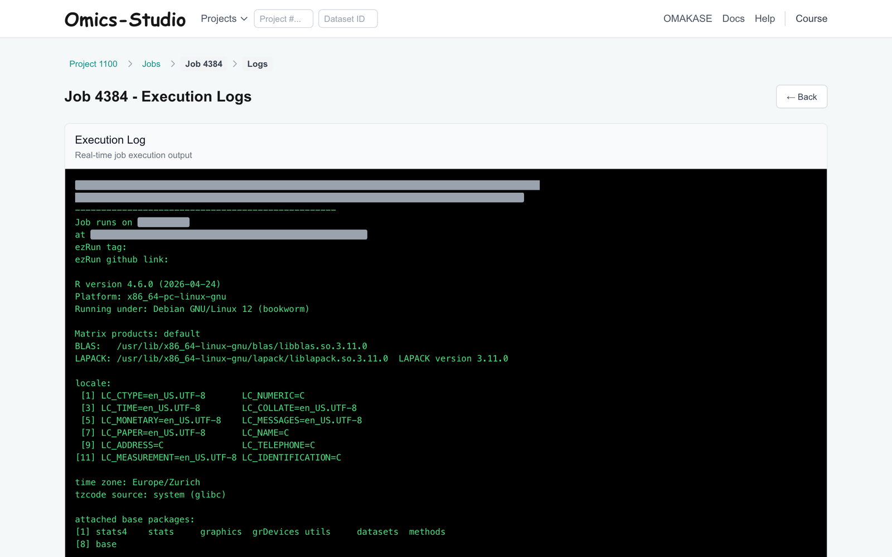

### 9. Open the FastQC dataset

Back in **DataSets**, a new dataset `Fastqc` has appeared under your RNA-seq dataset: the input is the parent,
the result is the child. Open it. **MultiQC Report** shows all samples together; the per-sample FastQC reports
and every other file are in **Data Folder**.

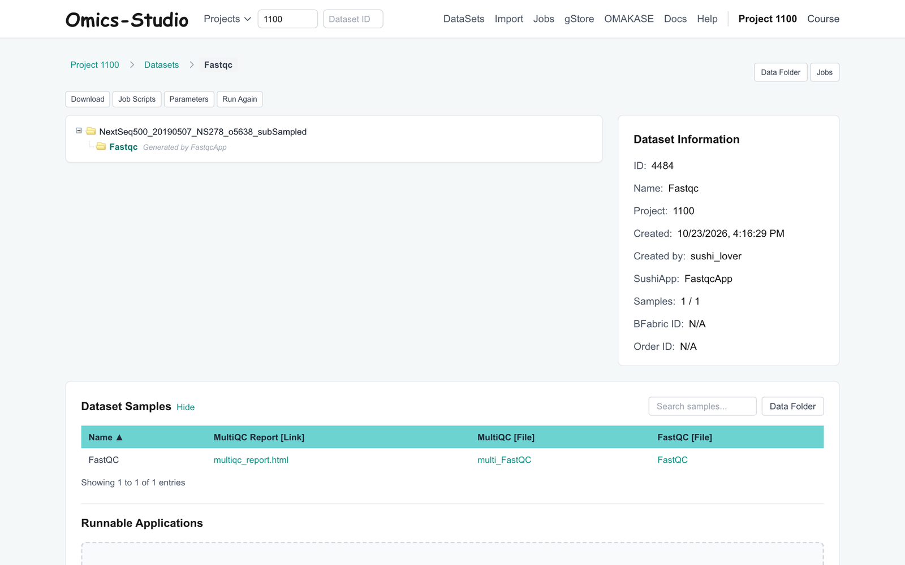

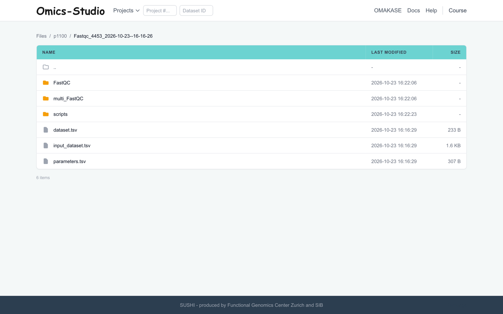

### 10. Questions

#### Quantity

- **Question 1**: Which, if any, samples are overrepresented?

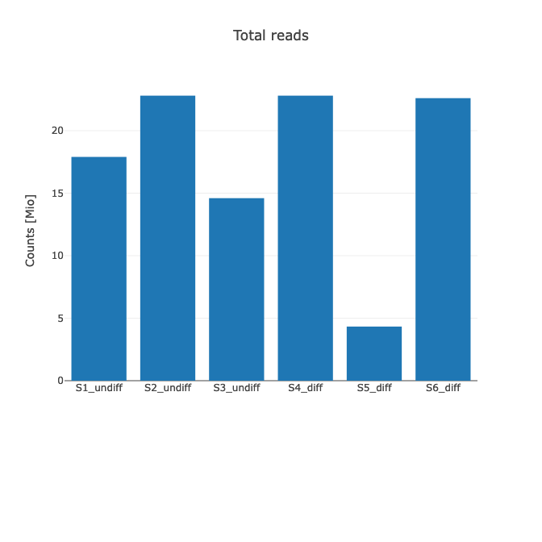

#### Quality

- **Question 2**: Are there differences in base quality scores across or within the samples?

- **Question 3**: Is there any adapter contamination in any of the samples? What might be the cause of this?

- **Question 4**: What would be a good preprocessing strategy for this data?

Next: [Exercise2 Read Mapping and IGV](Exercise_2.md)
