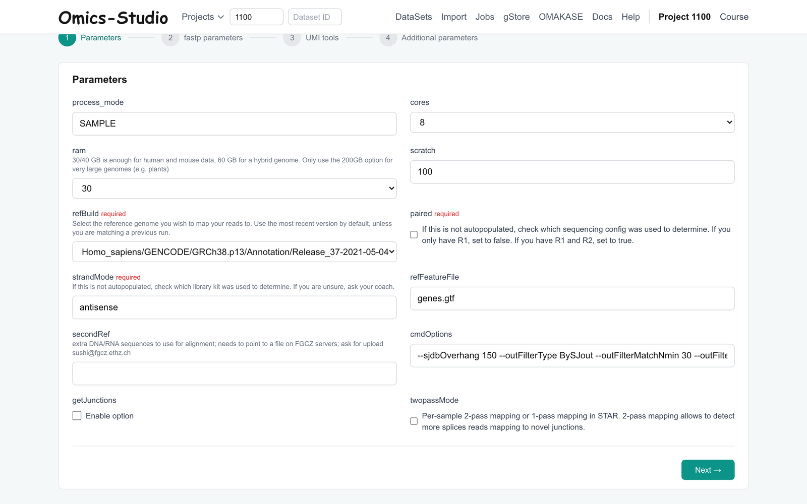
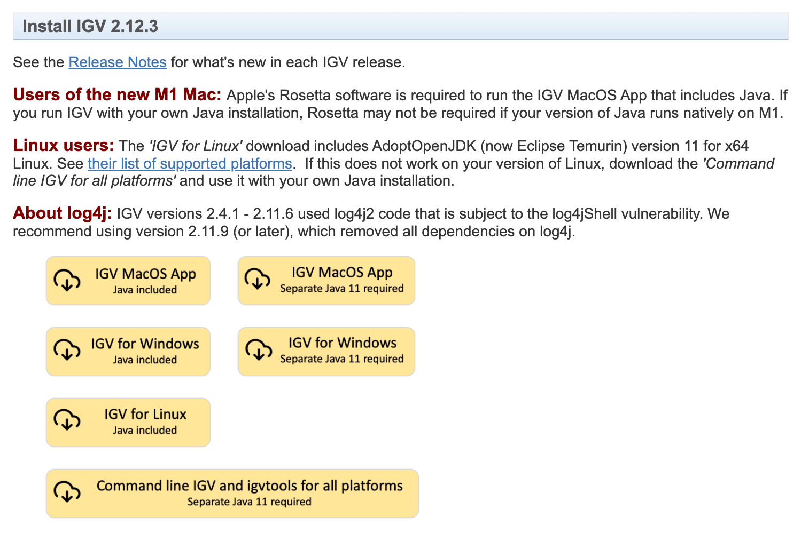
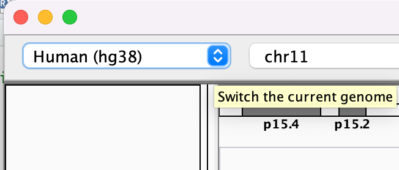
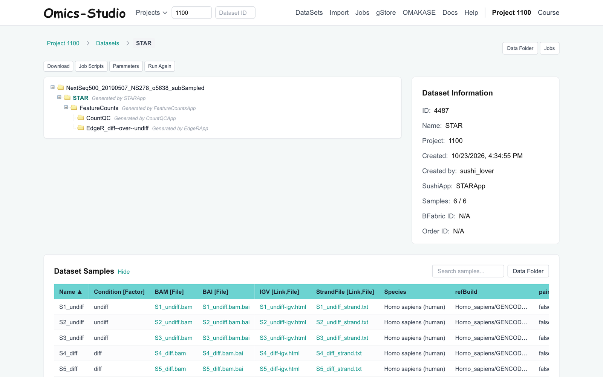
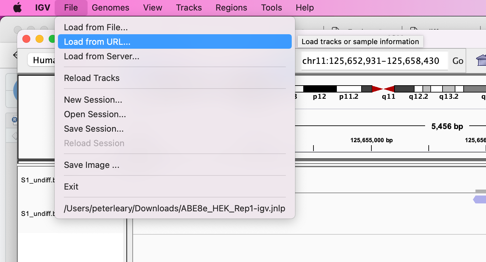
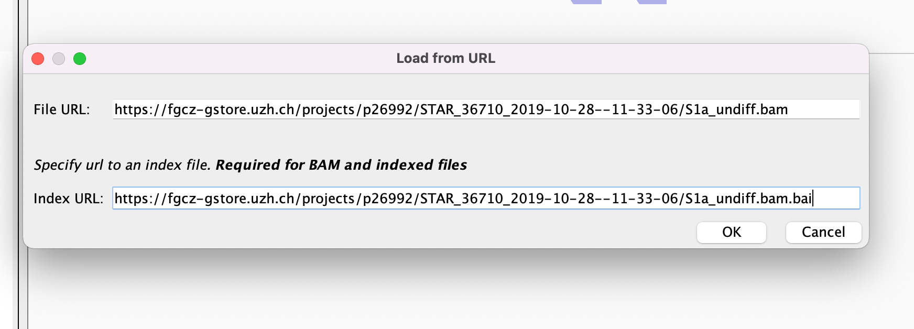
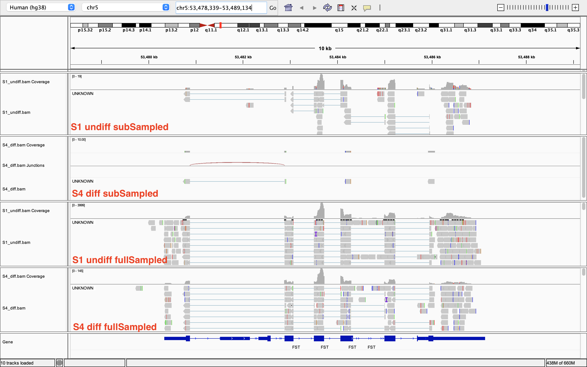
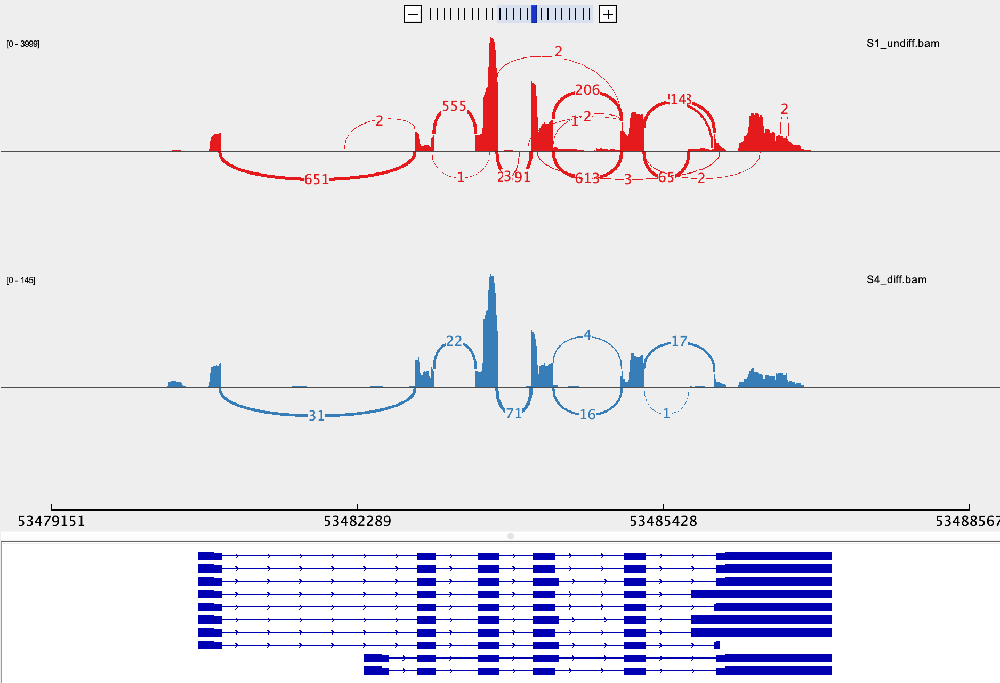

# Exercise 2 - Read Mapping and IGV
- Author: FGCZ
- Date: 26/04/2024, steps rewritten for Omics-Studio 25/10/2026

Steps
1. [Go back to the RNA-seq dataset and select STARApp](#1-go-back-to-the-rna-seq-dataset-and-select-starapp)
2. [Select parameters](#2-select-some-required-parameters-and-preprocessing-options)
3. [Submit the job](#3-submit-the-job)
4. [Download and install IGV](#4-download-and-install-igv-on-your-computer)
5. [Open IGV](#5-open-igv)
6. [Load the BAM files into IGV](#6-load-the-bam-files-into-igv)
7. [Questions](#7-questions)

----

### 1. Go back to the RNA-seq dataset and select STARApp

Open the RNA-seq dataset again (`NextSeq500_20190507_NS278_o5638_subSampled`, the parent), not the FastQC
result: the FastQC result holds reports, not reads, so it has no apps to run.
In **Runnable Applications**, select `STARApp` in the **Map** row.

### 2. Select some required parameters and preprocessing options

You will need a `refBuild` reference genome at the very least. We will use **Homo_sapiens/GENCODE/GRCh38.p13/Annotation/Release_37-2021-05-04**

Ensure the other options such as `paired` and `strandMode` are correct (they are filled in from the dataset but still require double-checking!)

Take a look at the `fastp` preprocessing parameters. Do we want to trim some of the front bases off? Maybe we can change `trim_front1` to 4.

### 3. Submit the job

Click **Next →** through the pages and **Continue to Review →**, check your chosen parameters again, then
**Confirm & Submit Job**. STAR takes longer than FastQC: follow it under **Jobs** and continue with IGV meanwhile.

### 4. Download and install IGV on your computer

URL: https://software.broadinstitute.org/software/igv/download

Should include Java as required.

### 5. Open IGV

Download the correct reference, which in our case, is **Human (hg38)**. If you can't see it on the list, click "More".

### 6. Load the BAM files into IGV

In IGV, **File → Load from URL**, paste the link of a BAM file and the link of its index (`.bai`).
Load samples `S1_undiff` and `S4_diff`, so we have one from each condition.

Where to get the links: open your STAR result dataset; in the sample table, right-click the file in the
`BAM` column and the one in the `BAI` column and copy the link. The **Data Folder** lists the same files.

Do not use the link in the `IGV` column: it opens a page that asks for an FGCZ sign-in and does not hold course data.

#### Full data for FST

Your BAM files come from only 100 000 reads a sample, so FST has only a few reads on it. To see how the full
data look, load these instead. They hold every read of `S1_undiff` and `S4_diff` in the FST region
(chr5:53,470,000-53,500,000), taken from the full data of the same samples. (Those were mapped to a newer
GENCODE release, 48; viewed on hg38 in IGV this makes no difference.)

* S1_undiff (735 KB): [BAM](https://github.com/masaomi/bio610_2026_practice/raw/main/data/igv_full_FST/S1_undiff_full_FST.bam) and its [index](https://github.com/masaomi/bio610_2026_practice/raw/main/data/igv_full_FST/S1_undiff_full_FST.bam.bai)
* S4_diff (32 KB): [BAM](https://github.com/masaomi/bio610_2026_practice/raw/main/data/igv_full_FST/S4_diff_full_FST.bam) and its [index](https://github.com/masaomi/bio610_2026_practice/raw/main/data/igv_full_FST/S4_diff_full_FST.bam.bai)

In IGV, **File → Load from URL** and paste the BAM link and the index link, as above. Or download both files
of a sample into one folder and use **File → Load from File**. Then type *FST* in the box left of "Go".

### 7. Questions

- **Question 1**: What is the gene model? Do our reads map to the right part of the gene? (Hint: Take a look at the annotation track at the bottom, You can search *FST* gene at the box left side to the "Go" button)

- **Question 2**: Is the gene expressed in samples from both conditions?

- **Question 3**: Is there a difference in the read coverage between samples from both conditions? (Hint: Take a look at the number of reads in the coverage track)

- **Question 4**: How many isoforms are identified? (Hint: You can open **Sashimi plot** by right click menu)

- **Question 5**: Look at the splice junctions, which isoforms are present almost exclusively in one sample? Which sample?

Next: [Exercise3 Feature Counts](Exercise_3.md)
