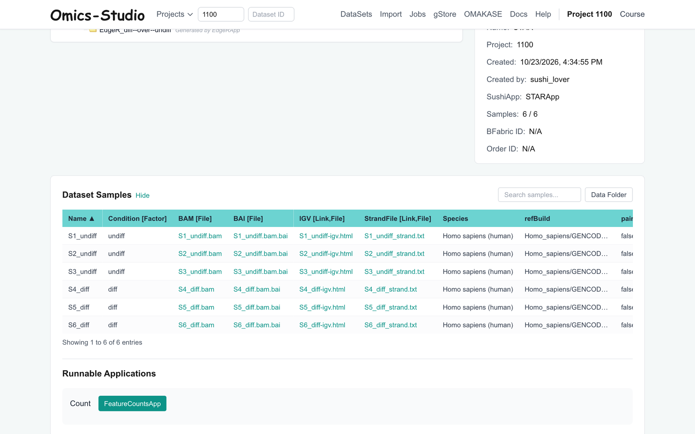
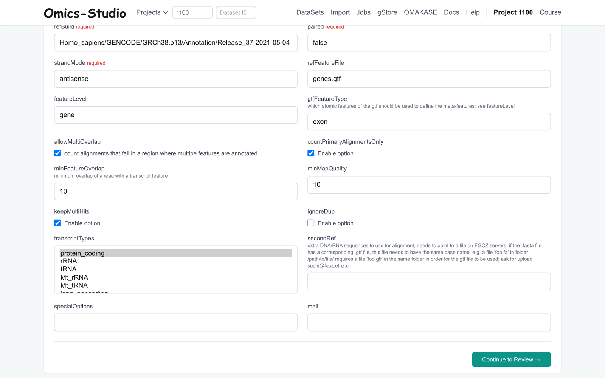
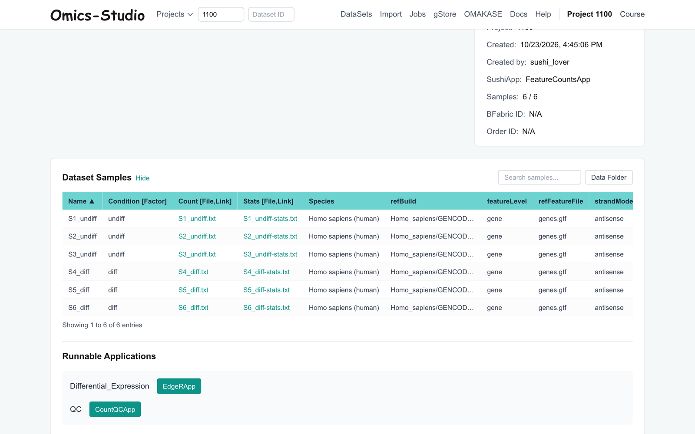
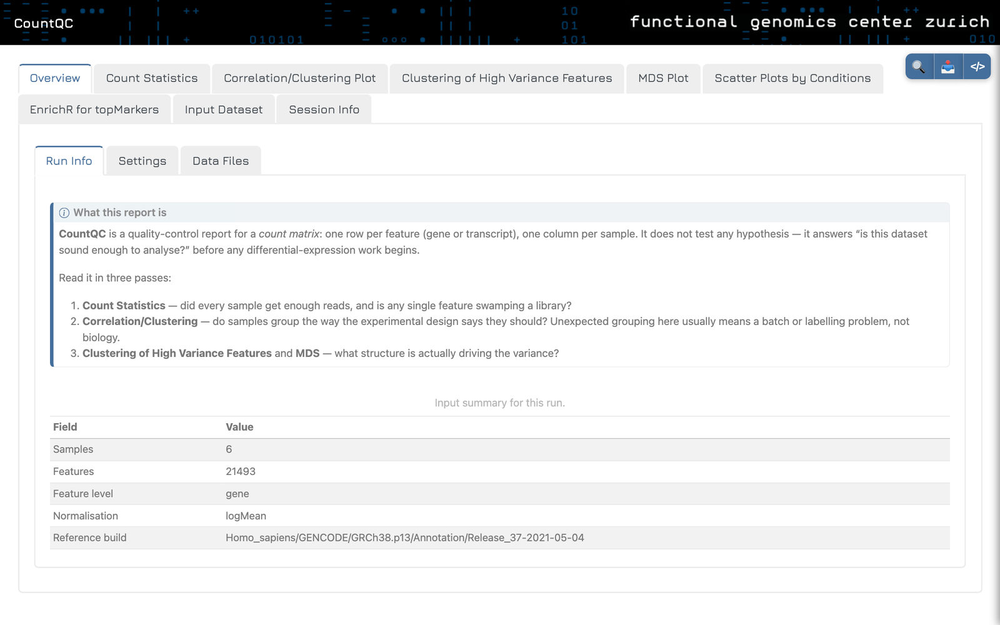
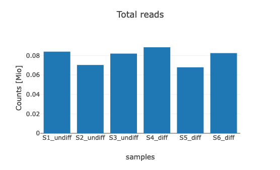
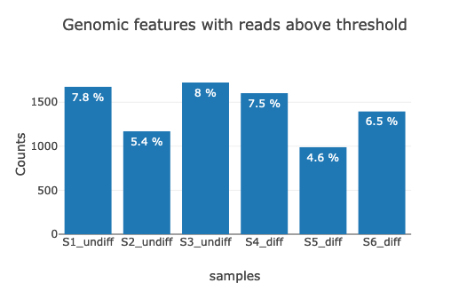
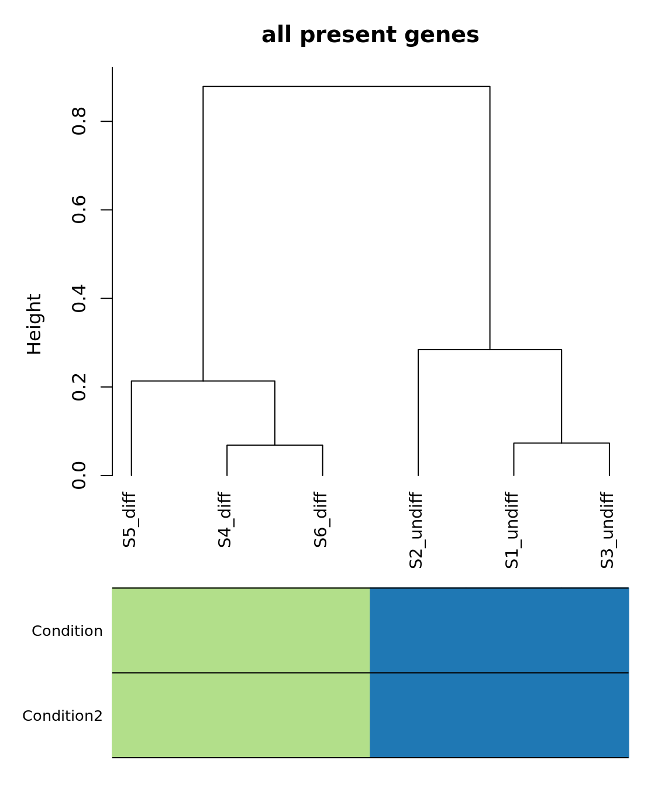
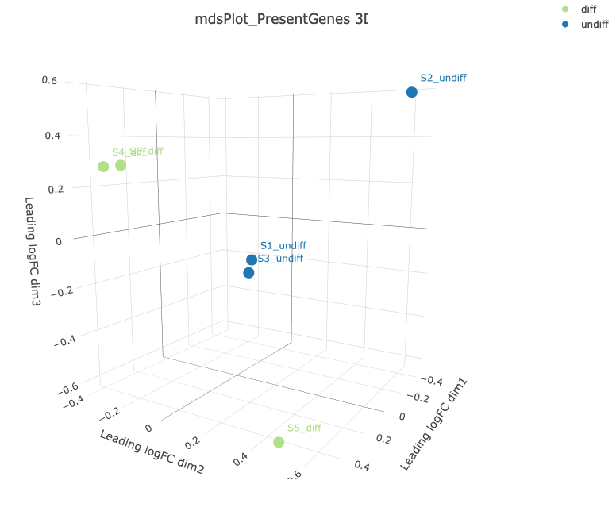

# Exercise 3 - Feature Counts
- Author: FGCZ
- Date: 26/04/2024, steps rewritten for Omics-Studio 25/10/2026

Steps
1. [Open the STAR dataset and run FeatureCountsApp](#1-open-the-star-dataset-and-run-featurecountsapp)
2. [Run CountQC on the resulting FeatureCounts dataset](#2-run-countqc-on-the-resulting-featurecounts-dataset)
3. [Explore the CountQC Static Report](#3-explore-the-countqc-static-report)

----

### 1. Open the STAR dataset and run FeatureCountsApp

When your STAR job is `COMPLETED`, open the `STAR` dataset (a child of your RNA-seq dataset).
In **Runnable Applications**, select `FeatureCountsApp` in the **Count** row. Check the settings, the defaults
should be fine. **Continue to Review →**, then **Confirm & Submit Job**.

`refBuild`, `paired` and `strandMode` are taken over from the STAR result.

Options
* We can exclude multi-mapped reads here (`keepMultiHits`, `countPrimaryAlignmentsOnly`) if you desire *exact* mapped reads (unnecessary in nearly all bulk RNA seq runs). You can also select multiple transcript types here (`transcriptTypes`), *e.g.*, if you have total RNA seq data (like ribo-depleted as opposed to poly-A selected).

### 2. Run CountQC on the resulting FeatureCounts dataset

Open the new `FeatureCounts` dataset. In **Runnable Applications**, select `CountQCApp` in the **QC** row and
submit it with the defaults.

### 3. Explore the CountQC Static Report

When CountQC is `COMPLETED`, open the `CountQC` dataset and click **Static Report**.

#### General QC

- **Question 1**: How many reads are in our final CountQC report, compared with our initial FastQC report?

- **Question 2**: How many features (in %) are above the threshold?

- **Question 3**: How best to proceed with underrepresented libraries? Generate more reads, or exclude them?

#### Sample and gene clustering

- **Question 4**: How do the samples cluster in the dendrogram?

- **Question 5**: Are there any outliers? Would you retain or exclude these from downstream analysis?

- **Question 6**: Are there any biologically-relevant gene clusters? (Hint: Look at the clustering of high variance features. Rows represent genes, columns are samples.)

- **Question 7**: Look at the multidimensional scaling (MDS) plots. How are the samples separated along the three dimensions?

Next: [Exercise4 Differential Expression](Exercise_4.md)
