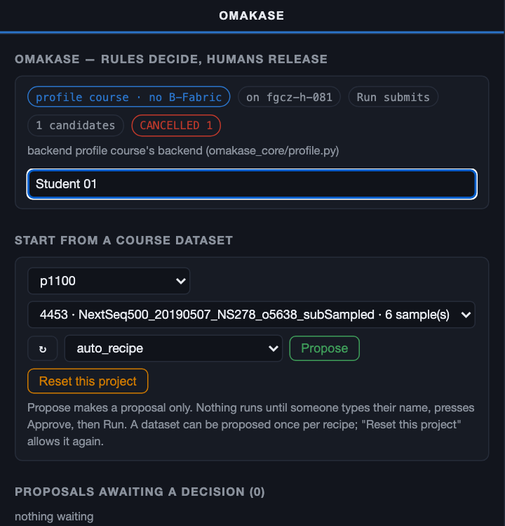
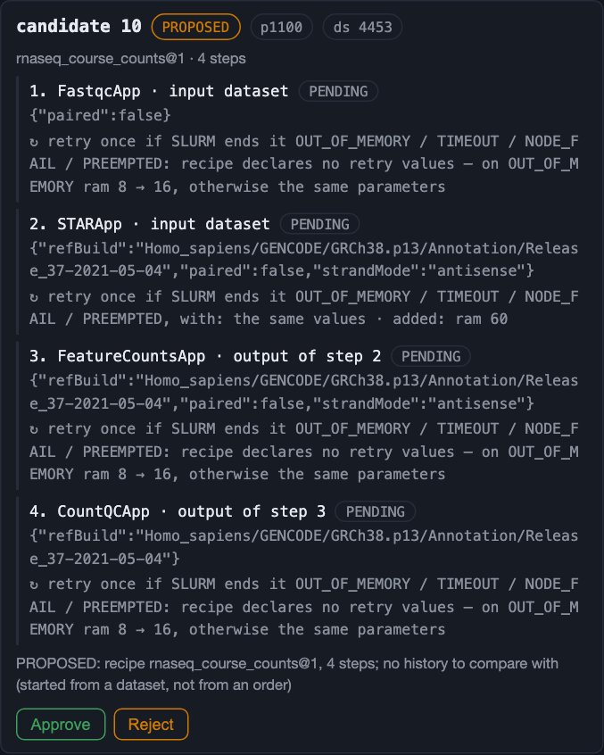
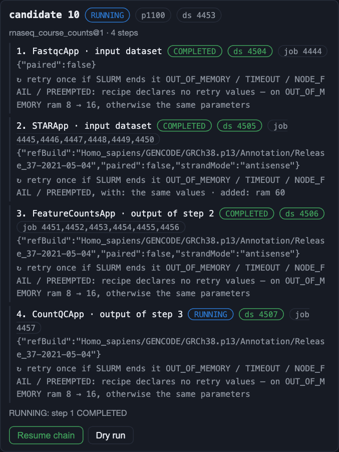
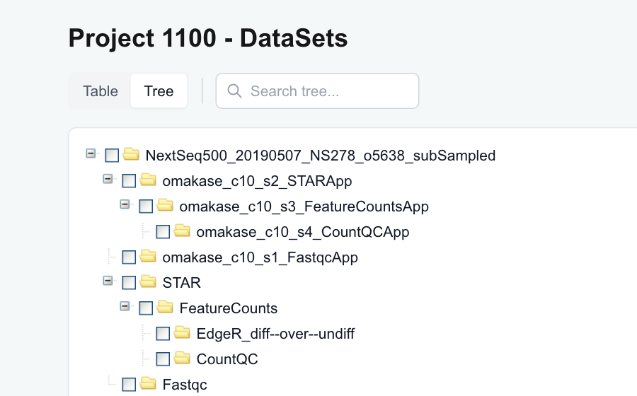

# Exercise 6 - OMAKASE: propose, approve, run
- Author: FGCZ
- Date: 28/10/2026

In Exercises 1-4 you started each app by hand, one after another: FastQC, then STAR, then
featureCounts, then CountQC. **OMAKASE** is a prototype that does this for you. It **proposes**
a chain of existing apps (a **recipe**). A person reads the proposal and **approves** it. Then
OMAKASE **runs** the whole chain to the end, or stops and says why.

OMAKASE = **O**mics **M**etadata **A**utomated **K**nowledge-based **A**nalysis
**S**uggestion & **E**xecution (the name is provisional). Its rule:

> **Rules decide, AI assists, humans release.**

With the recipe `auto_recipe`, OMAKASE chooses the chain for your dataset. In the course it is
Exercises 1-3 in one go:

```
 FastQC ┐ start together
 STAR   ┘ ──▶ featureCounts ──▶ CountQC
          (waits for STAR only)  (waits for featureCounts)
```

The recipe also fixes the settings: STAR uses the same reference genome you chose in Exercise 2
(GRCh38.p13, GENCODE Release 37), single-end reads, strandMode antisense.

Work in **your own project** (the same one as in Exercises 1-4).

Steps
1. [Open OMAKASE](#1-open-omakase)
2. [Type your name](#2-type-your-name)
3. [Choose your project and dataset, then Propose](#3-choose-your-project-and-dataset-then-propose)
4. [Read the proposal](#4-read-the-proposal)
5. [Approve](#5-approve)
6. [Run the chain](#6-run-the-chain)
7. [Watch it in Omics-Studio](#7-watch-it-in-omics-studio)
8. [Questions](#8-questions)

----

### 1. Open OMAKASE

In the course Omics-Studio (https://fgcz-course2.bfabric.org), click **OMAKASE** in the header.
The panel opens in a new tab. No sign-in, as in Omics-Studio.


### 2. Type your name

Type your name in the box at the top of the panel (**your name (required to approve)**).
It is needed to approve, to run and to reset, and it is recorded as the person who released the chain.

### 3. Choose your project and dataset, then Propose

Under **Start from a course dataset**, choose your project (p1101, p1102, ...) and the dataset
`NextSeq500_20190507_NS278_o5638_subSampled`. Keep the recipe **auto_recipe** (the first entry).
Press **Propose**.



**Propose** makes a proposal only. Nothing runs until someone types their name, presses
**Approve**, then **Run chain**.

### 4. Read the proposal

The proposal appears under **Proposals awaiting a decision**, with a number (the *candidate*
number). Note it. Read:

- the steps, and which step waits for which;
- the parameters of each step;
- the **reference genome**.

Nothing has been submitted to the cluster yet.



### 5. Approve

Is this proposal right for this dataset? If yes, press **Approve** (or **Reject** if not). The name you
typed in step 2 is recorded as the approver.

### 6. Run the chain

Press **Run chain** (not **Dry run**, which submits nothing). The chain takes about 8 minutes when the cluster is free (test run on 26 October:
FastQC 6 min and STAR 3 min side by side, then featureCounts 2 min, then CountQC 3 min). It
takes longer when the whole class runs at once. The proposal shows each step's state: PENDING,
RUNNING, COMPLETED, with the new dataset and job numbers.



### 7. Watch it in Omics-Studio

While it runs, open the **Jobs** page of your project in Omics-Studio. Watch which jobs start
first and which one waits.

When the panel shows the chain as done, open **DataSets**. There is one new dataset per step,
named `omakase_c<candidate>_s<step>_<App>`, for example `omakase_c10_s3_FeatureCountsApp`. They
sit in the same tree as your results from Exercises 1-3: compare them.



**Run it again?** A dataset can be proposed once per recipe. **Reset this project** (with your name
typed) lets you propose it again. Press it only for your own project.

### The course assistant

During the course session (28 October, 13.00-17.00) the right-hand column of the panel has a
**course assistant**: ask it about OMAKASE, your jobs, what the course apps do, or how to use
Omics-Studio. It only reads: it cannot propose, approve, run or reset anything, and nothing you type
is recorded. For the questions below it gives hints, not answers.

### 8. Questions

- **Question 1 (step 3)**: You did not pick the recipe; OMAKASE did, by a rule. At FGCZ,
  choosing the most common chain from past orders of the same kind would have been right for
  only about one order in five (~20 %). Why does OMAKASE still ask a person before anything runs?

- **Question 2 (step 4)**: Which reference genome is in the proposal? Is it the one you chose
  in Exercise 2? Why does that matter when you compare the two results?

- **Question 3 (step 7)**: Which jobs started at the same time? Why does featureCounts wait for
  STAR but not for FastQC?

- **Question 4 (step 5)**: Where can you see who approved the chain? In this course nobody signs
  in, so the name is whatever was typed. What does that mean for the record?

- **Question 5**: If STAR had failed, what should happen to featureCounts? (Hint: think about
  what featureCounts needs as input.)

- **Question 6**: The recipe stops at CountQC. There is no differential expression step like
  Exercise 4. In Exercise 4, which choice did you have to make yourself? Why is that choice hard
  to automate?

- **Question 7**: Compare Exercises 1-3 (you started each app) with this exercise (a recipe and
  a recorded approval). What does each way record about **how** the result was made?

### If the panel is not available

Your instructor runs steps 2-6 on the screen in the instructor's project (p1100). Answer the
questions from what you see, and follow the jobs on the screen.
